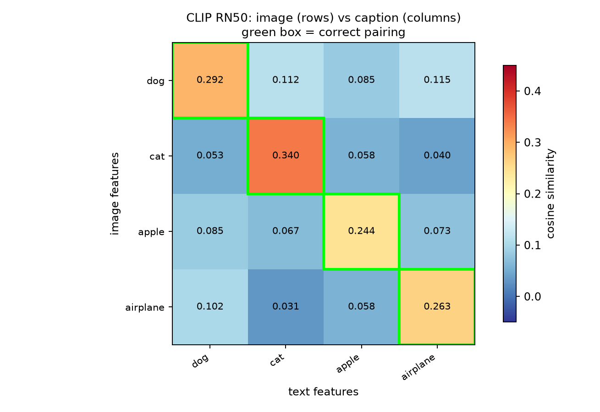

# Jotang-ml-task5 — CLIP：从论文精读到图文配对实验

本仓库包含任务 1（CLIP 论文精读笔记）与任务 2（用 OpenAI 官方 CLIP + 公开权重 `RN50`
做图文配对推理实验）的完整交付物。

## 目录

```text
.
├── README.md                     # 本文件
├── requirements.txt              # 运行环境依赖
├── task1_CLIP阅读笔记.md          # 任务 1：论文笔记（8 个问题 + 7 个思考题 + 应用场景）
└── task2_clip_pairing/           # 任务 2：图文配对实验
    ├── README.md                 # 实验报告（含全部结果与原因分析）
    ├── clip_pairing.py           # 主实验脚本（推理）
    ├── fetch_images.py           # 图片下载与来源/许可记录
    ├── images/                   # 4 张图片 + sources.json + ATTRIBUTION.md
    └── results/                  # 热力图、对比图、csv、json、完整日志
```

## 任务 1：CLIP 论文阅读笔记

[`task1_CLIP阅读笔记.md`](task1_CLIP阅读笔记.md) 覆盖：

1. 传统图像分类的数据需求 vs CLIP 的互联网图文对（4 亿对 WIT）；
2. 图像编码器 + 文本编码器，以及"编码后得到同维向量"；
3. 图文对齐与共享嵌入空间；
4. Figure 1 中 `N` 图 × `N` 文 = `N×N` 个配对，对角线为正、其余 `N²−N` 为负；
5. 对称 InfoNCE / 多分类 N 对损失，正样本拉近、负样本推远；
6. zero-shot 分类：文本向量直接当分类器权重；
7. prompt engineering（`dog` vs `a photo of a dog`，模板集成 +3.5%）；
8. CLIP 的限制、互联网数据的偏见与错误关联，以及它给大模型训练带来的思想。

另附"趁热打铁"7 题：相似度的前提条件、L2 归一化与余弦相似度、损失为何双向、
zero-shot 的准确含义、温度系数对 softmax 的影响（含本仓库实验数据）、
"雪地—北极熊"式捷径学习的后果，以及 CLIP 的应用场景。

## 任务 2：让 CLIP 配对图片和文字

完整报告见 [`task2_clip_pairing/README.md`](task2_clip_pairing/README.md)。核心结果：

| 实验 | 结果 |
| --- | --- |
| 特征形状 | 图像 `(4, 1024)`、文本 `(4, 1024)`，归一化后模长为 1 |
| 4×4 余弦相似度矩阵 | 对角线全部最大，**top-1 配对 4/4**（正确配对 0.24–0.34，错误配对 0.03–0.12） |
| 加入"红色番茄"假描述 | apple 图仍选中正确描述（0.2439 vs 0.1845），但差距仅 0.059 |
| 逐项错误扰动 | 动作错 −0.146 > 物种错 −0.070 > 颜色/数量错 −0.050 |
| 提示词工程 | `a photo of a dog` 比裸词 `dog` 高 0.0138；写错颜色再降回去 |
| 温度扫描 | scale 100 → 概率≈one-hot；scale 1 → 接近均匀分布 |



## 复现

```bash
pip install -r requirements.txt
cd task2_clip_pairing
python clip_pairing.py      # 结果写入 results/（首次运行会自动下载 RN50 权重）
```

CPU 即可运行（本次实验在 CPU 上完成，单次运行约数秒）。
