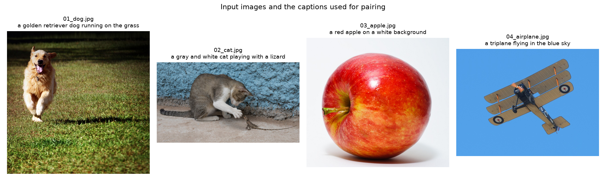
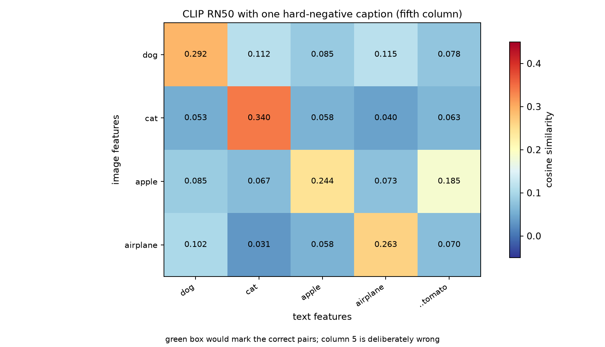
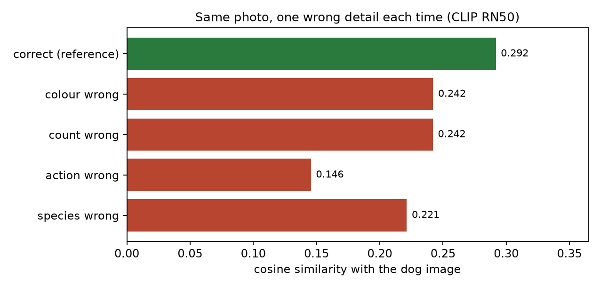
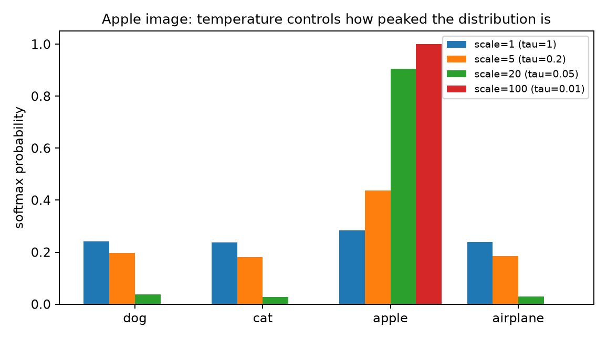

# 任务 2：让 CLIP 配对图片和文字

用 **OpenAI 官方 CLIP 实现 + 公开预训练权重 `RN50`** 做纯推理实验：
4 张图片 × 4 句英文描述，编码 → L2 归一化 → 余弦相似度矩阵 → 热力图，
再额外做"故意写错关键细节"的难负例实验、图片提示词工程实验与温度系数扫描。

## 运行方式

```bash
pip install -r ../requirements.txt   # 依赖清单在仓库根目录
python fetch_images.py    # 可选：从 Wikimedia Commons 重新下载 4 张图（含许可信息）
python clip_pairing.py    # 输出全部图表与日志到 results/
```

本仓库的 `results/` 里保存了本次运行的完整产物（图 + csv + json + 日志），
不重新下载模型也能直接看结果。CLIP 权重由 `clip.load("RN50")` 自动下载并缓存
（官方权重地址 `openaipublic.azureedge.net`，CPU 亦可运行，本次运行 device=cpu）。

## 1. 数据：4 张图片与描述

| # | 文件 | 英文描述（caption） | 来源 |
| --- | --- | --- | --- |
| 1 | `images/01_dog.jpg` | `a golden retriever dog running on the grass` | Wikimedia Commons, CC BY-SA 3.0 |
| 2 | `images/02_cat.jpg` | `a gray and white cat playing with a lizard` | Wikimedia Commons, CC BY-SA 4.0 (Basile Morin) |
| 3 | `images/03_apple.jpg` | `a red apple on a white background` | Wikimedia Commons, CC BY 2.0 (Abhijit Tembhekar) |
| 4 | `images/04_airplane.jpg` | `a triplane flying in the blue sky` | Wikimedia Commons, Public domain |

每张图都记录在 `images/sources.json`（原始文件名、作者、许可、原图分辨率、下载链接）与
[`images/ATTRIBUTION.md`](images/ATTRIBUTION.md)（可直接引用的署名信息）。
四张图内容互不相同（动物 / 动物 / 静物 / 飞行器），第 2 张还含有"猫 + 蜥蜴"两个物体，
方便观察多物体图片的配对行为。



## 2. 特征提取与 L2 归一化

```text
input image tensor    : (4, 3, 224, 224)
text  token shape     : (4, 77)          # CLIP 上下文长度 77
image features (raw)  : (4, 1024)        # 图像编码器 → 1024 维向量
text features  (raw)  : (4, 1024)        # 文本编码器 → 1024 维向量
```

图像侧用 `model.encode_image(preprocess(img))`，文本侧用
`model.encode_text(clip.tokenize(caption))`；两个编码器的输出维度相同（1024），
所以可以放进同一个空间做点积。**归一化前**两个模态的模长量级差别很大：

| 模态 | dog | cat | apple | airplane |
| --- | --- | --- | --- | --- |
| 图像特征 ‖f‖ | 1.866 | 2.096 | 2.818 | 1.944 |
| 文本特征 ‖f‖ | 8.763 | 9.148 | 9.186 | 10.240 |

归一化后所有向量模长都是 **1.0000**，此时点积严格等于余弦相似度，相似度矩阵才有可比性。

## 3. 4×4 相似度矩阵与配对结果


| image \ text | dog | cat | apple | airplane |
| --- | --- | --- | --- | --- |
| **dog** | **0.2917** | 0.1124 | 0.0855 | 0.1153 |
| **cat** | 0.0530 | **0.3401** | 0.0577 | 0.0404 |
| **apple** | 0.0855 | 0.0672 | **0.2439** | 0.0732 |
| **airplane** | 0.1022 | 0.0315 | 0.0583 | **0.2632** |

**top-1 配对：4/4 全部正确**

| 图片 | 预测 | 相似度 | 次优（runner-up） | 与次优差距 |
| --- | --- | --- | --- | --- |
| dog | dog | 0.2917 | airplane 0.1153 | +0.1764 |
| cat | cat | 0.3401 | apple 0.0577 | +0.2824 |
| apple | apple | 0.2439 | dog 0.0855 | +0.1584 |
| airplane | airplane | 0.2632 | dog 0.1022 | +0.1610 |

**为什么成功：**

- 四张图的语义彼此远离（动物/水果/飞机），而每句描述都写明了主体类别，
  共享空间里的方向自然分开；对角线相似度（0.24–0.34）明显高于非对角线（多数 < 0.12）。
- 有意思的是"主体之外的词"也在起作用：猫的图片里含蜥蜴、蓝墙，
  但 caption 里的 `cat` 与画面主体一致，所以仍以 0.34 的最高分获胜；
  dog 行里 `airplane` 反而是次优（0.1153），说明背景里的天空/草地纹理给了弱信号。

**值得注意的现象：**

- 正确配对的相似度绝对值并不高（0.24–0.34）。CLIP 的嵌入不是"越像越接近 1"，
  而是**相对排序**重要；这也是为什么官方用 `logit_scale * sim` 再 softmax，
  而不是直接拿余弦值当概率。
- 用官方权重里的 `logit_scale = 100.0` 做 softmax 后，正确类别概率直接是 `1.00000`，
  其余全是 `0.0000x`（见 `results/experiment_log.txt`）——见第 6 节的温度分析。

## 4. 故意加入"相似但关键内容错误"的描述

第 5 句：**`a red tomato on a white background`**（与第 3 张 apple 图几乎同构：红色、
圆形、白底，但物体错了）。



| image \ text | dog | cat | apple | airplane | **a red tomato…** |
| --- | --- | --- | --- | --- | --- |
| dog | 0.2917 | 0.1124 | 0.0855 | 0.1153 | 0.0779 |
| cat | 0.0530 | 0.3401 | 0.0577 | 0.0404 | 0.0630 |
| **apple** | 0.0855 | 0.0672 | **0.2439** | 0.0732 | **0.1845** |
| airplane | 0.1022 | 0.0315 | 0.0583 | 0.2632 | 0.0697 |

**观察：**

- CLIP **没有**被这句假描述骗到：apple 图与 `a red apple…` 的相似度 0.2439
  仍然高于与 `a red tomato…` 的 0.1845（差距 **−0.0593**），top-1 配对依旧是 4/4。
- 但 `tomato` 得到的 0.1845 是**该句与所有图片中最高的**，而且远高于另外三张图
  在这句上的平均分 0.0702——说明"红色 + 圆形 + 白底"的外观线索确实被 CLIP 认成"很像"，
  只是**类别语义（apple vs tomato）**这一关键细节把它压下来了。
- 这正是论文提到的 CLIP 弱点：**相近类别/细粒度区分能力弱**。0.059 的分差在这个空间里
  属于"窄边取胜"，一旦图片更暗、更小、角度更偏，或提示词更模糊（例如只说 `a red fruit`），
  就可能翻盘。所以第 4 问要求"故意写错关键内容"的意义在于：
  CLIP 能分辨**明显错误**，但对**外观高度相似、只差一个关键属性**的描述只有微弱的置信度优势。

### 补充：同一张图、每次只错一个细节

对 dog 图片做 5 组提示词对照：



| 描述 | 余弦相似度 | 相对正确描述的落差 |
| --- | --- | --- |
| `a golden retriever dog running on the grass`（正确） | 0.2917 | — |
| `a black dog running on the grass`（颜色错） | 0.2421 | −0.0496 |
| `two dogs running on the grass`（数量错） | 0.2420 | −0.0498 |
| `a golden retriever sleeping on a bed`（动作/场景错） | 0.1455 | −0.1462 |
| `a white cat running on the grass`（物种错） | 0.2213 | −0.0704 |

结论：

1. 相似度随错误"严重程度"下降：**动作/场景错（−0.146）> 物种错（−0.070）>
   颜色错 ≈ 数量错（−0.050）**。
2. 有意思的是"颜色/数量错"的降幅反而小于"物种错"：说明 CLIP 对**主体类别与整体场景**
   最敏感，对**数量、颜色这类需要计数/细看细节的属性**敏感度较低
   （与论文"CLIP 不擅长计数、细粒度属性"的结论一致）。
3. 5 句中正确描述始终得分最高 → 在"选择最匹配的一句"这种排序任务上，
   CLIP 的鲁棒性比"绝对相似度阈值判断"要好得多。

## 5. 提示词工程：裸类别名 vs 模板 vs 集成

把 4 个类别名当作 zero-shot 分类的文本权重，对 4 张图分类（`image → 最相似的类别`）：

| 提示词方案 | 预测 | 准确率 |
| --- | --- | --- |
| 裸类别名 `dog/cat/apple/airplane` | dog, cat, apple, airplane | 4/4 |
| `a photo of a {label}` | dog, cat, apple, airplane | 4/4 |
| `a photo of a small {label}` | dog, cat, apple, airplane | 4/4 |
| `a photo of a large {label}` | dog, cat, apple, airplane | 4/4 |
| 8 个模板集成（取平均后归一化） | dog, cat, apple, airplane | 4/4 |

这个任务太容易（4 个类别的语义差距极大），所有方案都是 4/4；
但**相似度分数**能看出模板的差别——同一张狗图：

| prompt | 余弦相似度 |
| --- | --- |
| `dog` | 0.2009 |
| `a photo of a dog` | **0.2147** |
| `a photo of a black dog` | 0.1969 |

也就是：套上 `a photo of a ...` 模板后相似度提高 +0.0138（与论文"模板比裸词更好"一致），
而模板里写错颜色又会掉回去（−0.0178 vs 正确模板）。**要复现论文里"模板集成 +3.5%"的收益，
需要类别数多、类别名有歧义（如 `Boxer`/`crane`）或类别本身较难的数据集**，
这里只作为机制演示。

## 6. 温度系数（`logit_scale`）扫描

CLIP 用 `softmax(logit_scale · cosine_similarity)`，官方 RN50 权重里
`logit_scale = exp(logit_scale_param) = 100.0`，即温度 τ = 0.01。手动改这个缩放系数：

| scale = 1/τ | τ | 平均熵(nats) | 平均最大概率 | apple 图的 4 类分布 |
| --- | --- | --- | --- | --- |
| 1 | 1 | 1.381（接近均匀，ln4=1.386） | 0.29 | .242 / .237 / **.283** / .239 |
| 5 | 0.2 | 1.246 | 0.49 | .198 / .180 / **.436** / .186 |
| 20 | 0.05 | 0.272 | 0.94 | .038 / .027 / **.906** / .030 |
| 100（实际权重） | 0.01 | ≈0 | 1.00 | 0 / 0 / **1** / 0 |



**结论**：scale 变大（τ 变小）→ softmax 更尖锐、模型更"确信"；
scale 变小（τ 变大）→ 分布更平坦、模型更"犹豫"。
温度是训练中控制 logits 尺度与梯度强度的旋钮，论文把它作为可学习参数、
上限截断在 100（正是本次加载的权重值）。

## 7. 产物清单

| 文件 | 内容 |
| --- | --- |
| `fetch_images.py` | 从 Commons 按精确文件名下载图片并写 `sources.json` / `ATTRIBUTION.md` |
| `clip_pairing.py` | 全部实验（编码、归一化、4×4/5×5 矩阵、热力图、扰动、提示词、温度） |
| `results/similarity_4x4_heatmap.png` | 4×4 余弦相似度热力图（绿框 = 正确配对） |
| `results/similarity_5x5_heatmap.png` | 加入"红色番茄"假描述后的 5×5 热力图 |
| `results/caption_perturbation_dog.png` | 同一张图、每次只错一个细节的相似度对比 |
| `results/temperature_sweep_apple_row.png` | 温度系数对 softmax 分布的影响 |
| `results/images_overview.png` | 4 张输入图与对应描述 |
| `results/similarity_*.csv` | 矩阵原始数值（4×4、5×5、图×图） |
| `results/results.json` | 全部数值结果（便于程序化查看） |
| `results/experiment_log.txt` | 控制台完整日志（含特征形状、模长、概率、结论） |

## 8. 小结

1. CLIP 的两个编码器输出同维向量（1024），L2 归一化后点积即余弦相似度，
   于是"配对"变成一个纯粹的几何检索问题。
2. 4 张图的 4×4 矩阵对角线全部最大，top-1 配对 4/4；
   正确配对的相似度在 0.24–0.34，非对角多数在 0.03–0.12。
3. 加入"红色番茄"这类外观高度相似、语义错误的描述后，CLIP 仍以 0.059 的分差选出正确描述，
   说明它能抓住关键语义，但对细粒度/相似类别的分辨是"窄边取胜"，鲁棒性有限。
4. 逐项扰动表明：CLIP 对**主体类别与整体场景**最敏感，对**数量、颜色等细节**较不敏感。
5. 提示词模板与温度系数都会明显改变分数乃至结论 → 论文强调 prompt engineering
   与可学习温度并非细节，而是这套方法能工作的组成部分。
